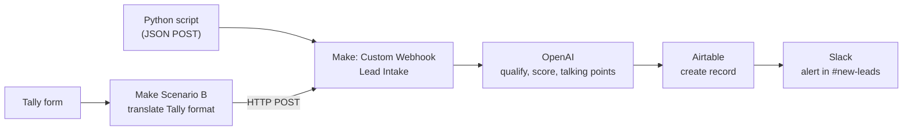

# Datheon: AI Automation & Agent Building

Internship project repository for the **Datheon AI Automation & Agent Building** program.

**Author:** Mohya-Aldeen Kudaish   &nbsp;|&nbsp; **GitHub:** [@ Mohya-Aldeen](https://github.com/ Mohya-Aldeen) &nbsp;|&nbsp; **LinkedIn:** [Mohya-Aldeen  ](https://www.linkedin.com/in/YOUR_PROFILE)

[English](#english) · [العربية](#arabic)

---

<a id="english"></a>

## English

### Purpose

Sales teams receive leads from many places (website forms, ads, scripts, other tools). Reading and judging each one by hand is slow, and the best leads wait in the queue.

This project is an **automation that qualifies leads with AI in a few seconds**. Every lead is captured the moment it arrives, an AI model judges how valuable it is, a structured record is stored, and the sales team gets a Slack alert with ready-made talking points.

### Task status

The program requires **2 or 3 completed tasks**. This table is updated as each one is finished.

| Task | Title | Status |
|---|---|---|
| 1 | Multi-Source Lead Routing & Instant AI Qualification | **Complete**: see [`task-1-lead-routing`](./task-1-lead-routing) |
| 2 | Autonomous Customer Support & Intelligent Email Triage | Planned |
| 3 | AI Vision Invoice Scanner & Accounting Sync | Not started |
| 4 | Capstone: Multi-Agent Enterprise Operations System | Not started |

### Task 1 at a glance



1. A lead arrives from **two sources**: a Python script that posts JSON to a webhook, and a **Tally** web form.
2. The Tally response is converted by a small second scenario (Scenario B) into the same flat format and forwarded to the same webhook, so every source follows one path.
3. **OpenAI** reads the lead and returns strict JSON: a **Hot / Warm / Cold** label, a 0 to 100 score, estimated company size and budget, a one-sentence reason, and three talking points.
4. **Airtable** stores one record per lead.
5. **Slack** posts an alert with the verdict, the reason, and the talking points.

### Tools used

| Tool | Role |
|---|---|
| Make.com | Orchestration: webhooks, scenario logic, connectors |
| OpenAI API | Lead qualification, returning JSON |
| Airtable | Database of qualified leads |
| Slack | Real-time alert to the sales team |
| Tally | Public lead form (second source) |
| Python (`requests`) | Test client: sample and edge-case leads |
| GitHub | Version control and submission |

### Key results

- **End-to-end time: about 4 seconds** (main scenario 3 s, Scenario B under 1 s), measured in Make's run history. The requirement was under 10 seconds.
- Tested with **edge cases**: empty fields, vague budget wording, and text with quotation marks and symbols.
- Two independent sources feed one pipeline.

### Repository structure

```
Datheon_AI_Automation_and_Agent_Building/
├── README.md
├── .gitignore
├── .env.example
└── task-1-lead-routing/
    ├── README.md          (architecture, setup, results, lessons)
    ├── requirements.txt
    ├── scripts/           (send_lead.py, test_edge_cases.py, common.py)
    ├── prompts/           (system prompt used in the OpenAI module)
    ├── blueprints/        (exported Make scenario JSON files)
    └── screenshots/       (runs, Airtable, Slack, timing)
```

### Security

No secrets are stored in this repo. The webhook URL is read from an environment variable or a local `.env` file (ignored by Git), and the OpenAI key lives only inside Make's connection.

---

<a id="arabic"></a>

<div dir="rtl" align="right">

## العربية

### الهدف

تستقبل فرق المبيعات طلبات العملاء المحتملين (Leads) من أماكن كثيرة: نماذج المواقع، الإعلانات، أدوات أخرى. وقراءة كل طلب وتقييمه يدويًا تستهلك وقتًا، وقد ينتظر أفضل العملاء في الطابور.

هذا المشروع نظام أتمتة **يقيّم العملاء المحتملين بالذكاء الاصطناعي خلال ثوانٍ**. يلتقط كل طلب لحظة وصوله، ويحلله نموذج ذكاء اصطناعي، ويحفظ سجلًا منظمًا، ثم يرسل لفريق المبيعات تنبيهًا في Slack مع نقاط حوار جاهزة.

### حالة المهام

يشترط البرنامج **إنجاز مهمتين أو ثلاث**. يُحدَّث هذا الجدول مع إنهاء كل مهمة.

| المهمة | العنوان | الحالة |
|---|---|---|
| 1 | توجيه العملاء المحتملين من مصادر متعددة وتقييمهم فورًا بالذكاء الاصطناعي | **مكتملة**: انظر [`task-1-lead-routing`](./task-1-lead-routing) |
| 2 | دعم العملاء الآلي وفرز البريد الإلكتروني الذكي | مخطط لها |
| 3 | قارئ الفواتير بالرؤية الحاسوبية ومزامنة المحاسبة | لم تبدأ |
| 4 | المشروع الختامي: نظام عمليات متعدد الوكلاء | لم تبدأ |

### المهمة الأولى باختصار

1. يصل العميل المحتمل من **مصدرين**: سكربت بايثون يرسل بيانات JSON إلى Webhook، ونموذج ويب من **Tally**.
2. يحوّل سيناريو ثانٍ (Scenario B) بيانات Tally إلى الصيغة الموحدة نفسها ويرسلها إلى Webhook ذاته، فيسلك كل مصدر المسار نفسه.
3. يقرأ **OpenAI** بيانات العميل ويعيد نتيجة بصيغة JSON صارمة: التصنيف **Hot / Warm / Cold**، ودرجة من 0 إلى 100، وحجم الشركة والميزانية المقدّرين، وسببًا في جملة واحدة، وثلاث نقاط حوار.
4. يحفظ **Airtable** سجلًا واحدًا لكل عميل.
5. يرسل **Slack** تنبيهًا يتضمن التصنيف والسبب ونقاط الحوار.

### الأدوات المستخدمة

| الأداة | دورها |
|---|---|
| Make.com | تنسيق سير العمل: Webhooks والمنطق والموصّلات |
| OpenAI API | تقييم العميل وإرجاع النتيجة بصيغة JSON |
| Airtable | قاعدة بيانات العملاء المقيَّمين |
| Slack | تنبيه فوري لفريق المبيعات |
| Tally | نموذج التقاط العملاء (المصدر الثاني) |
| Python (`requests`) | عميل اختبار: عملاء تجريبيون وحالات صعبة |
| GitHub | إدارة الإصدارات والتسليم |

### أهم النتائج

- **زمن التنفيذ الكامل نحو 4 ثوانٍ** (السيناريو الرئيسي 3 ثوانٍ، وسيناريو Tally أقل من ثانية)، حسب سجل التشغيل في Make. والمطلوب أقل من 10 ثوانٍ.
- اختبار **حالات صعبة**: حقول فارغة، ميزانية غير واضحة، ونص يحتوي علامات اقتباس ورموزًا.
- مصدران مستقلان يغذّيان مسارًا واحدًا.

### هيكل المستودع

```
Datheon_AI_Automation_and_Agent_Building/
├── README.md
├── .gitignore
├── .env.example
└── task-1-lead-routing/
    ├── README.md          (البنية، الإعداد، النتائج، الدروس)
    ├── requirements.txt
    ├── scripts/           (سكربتات الاختبار)
    ├── prompts/           (التعليمات المستخدمة في OpenAI)
    ├── blueprints/        (ملفات JSON المصدّرة من Make)
    └── screenshots/       (لقطات التشغيل)
```

### الأمان

لا يحتوي المستودع على أي أسرار. يُقرأ رابط الـ Webhook من متغير بيئة أو من ملف `.env` محلي يتجاهله Git، ومفتاح OpenAI محفوظ داخل اتصال Make فقط.

</div>
