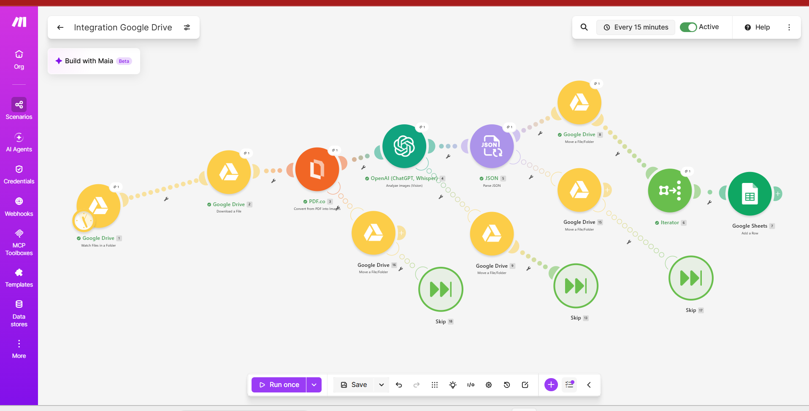
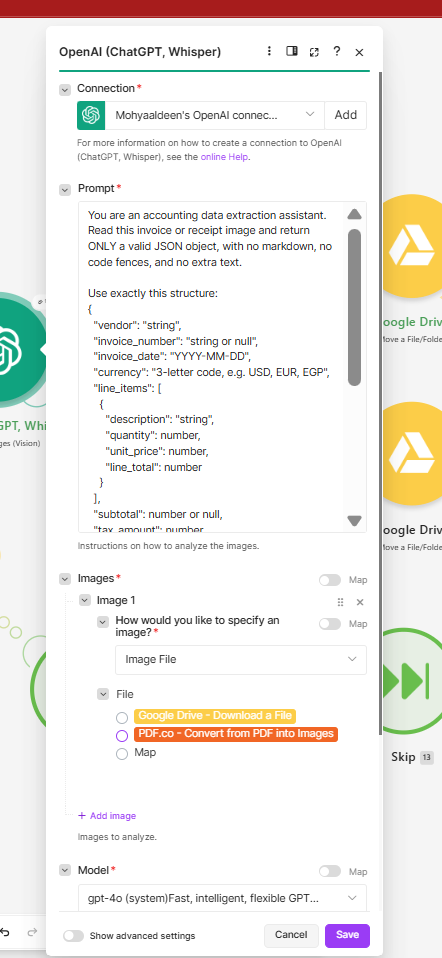
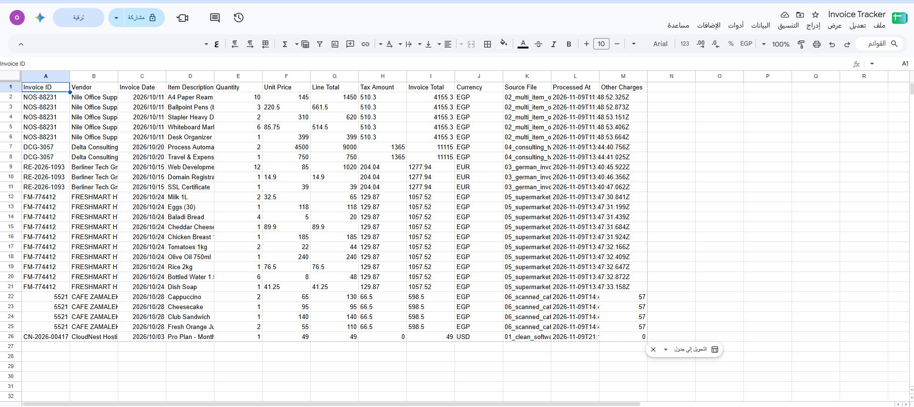
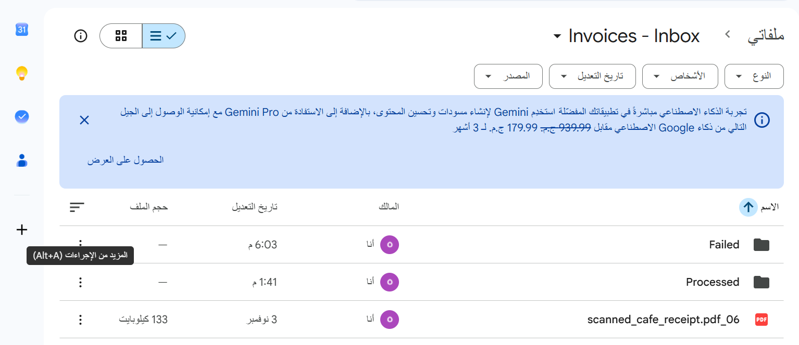

# AI Vision Invoice Scanner & Accounting Sync

An automated pipeline that reads PDF invoices and receipts dropped into a Google Drive folder, extracts the financial data with OpenAI Vision, and writes one row per line item into Google Sheets. It replaces manual expense bookkeeping.

**Tools:** Make.com, OpenAI Vision (GPT-4o), PDF.co, Google Drive, Google Sheets

## How it works

```
Google Drive (Invoices - Inbox)
  -> Download PDF
  -> PDF.co: convert PDF to JPG
  -> OpenAI Vision: extract data as JSON
  -> Parse JSON
  -> Move file to "Processed"
  -> Iterator (one bundle per line item)
  -> Google Sheets: add a row per line item
```

1. A new PDF appears in the **Invoices - Inbox** folder (checked every 15 minutes).
2. The PDF is downloaded and converted to an image, because OpenAI Vision reads images, not PDFs.
3. OpenAI Vision returns structured JSON (vendor, invoice number, date, currency, line items, tax, other charges, total). The prompt uses temperature 0 and instructs the model to return `null` instead of guessing.
4. The JSON is parsed, and the file is moved to **Processed** so it can never be read twice.
5. An Iterator turns each line item into its own sheet row.

## Screenshots

### Make scenario (with error-handling routes)


### OpenAI Vision extraction prompt


### Extracted data in Google Sheets


### Drive folder structure


## Google Sheet columns

`Invoice ID | Vendor | Invoice Date | Item Description | Quantity | Unit Price | Line Total | Tax Amount | Invoice Total | Currency | Source File | Processed At | Other Charges`

## Error handling

Error routes on the download, conversion, AI, and parsing steps move the failing file to a **Failed** folder and let the scenario continue, so one bad file never blocks the others.

## Testing

Tested on 6 synthetic documents covering different layouts, currencies (USD, EUR, EGP), tax labels (Sales Tax, VAT, MwSt), a 10-item supermarket receipt, and a rotated, blurry scanned receipt with a service charge. Every extracted value (vendor, invoice number, date, line items, tax, total) matched the known correct answers. A corrupt PDF was correctly routed to the Failed folder.

## Repository contents

- `screenshots/`: scenario, prompt, results, and folder structure
- `sample-data/`: 6 fictional test documents and `ANSWER_KEY.csv` with the expected values
- `blueprint/`: exported Make scenario (import it via Make's *Import Blueprint*)

## Setup

1. Create a Google Drive folder **Invoices - Inbox** with subfolders **Processed** and **Failed**.
2. Create a Google Sheet with the columns above.
3. In Make, build the scenario with the modules listed above and connect Google, PDF.co, and OpenAI (API key).
4. Set the trigger to start **From now on**, set the schedule, and activate the scenario.

## Known limitations

- Invoice-level values (Tax Amount, Invoice Total) repeat on every line-item row, so summing those columns counts each invoice multiple times.
- Documents that are not invoices are not rejected; they are moved to Processed without creating rows.
- Free-tier credit limits apply to Make, PDF.co, and OpenAI.

## Possible improvements

- Validation that line totals plus tax and charges equal the invoice total, flagging mismatches for review
- A summary tab with one row per invoice
- A filter that sends non-invoice documents to the Failed folder
