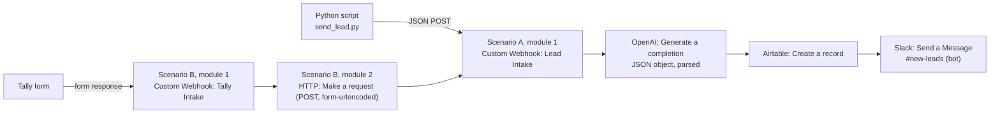

# Task 1: Multi-Source Lead Routing & Instant AI Qualification

**Goal (from the Datheon task):** ingest lead form entries, evaluate company size and budget with OpenAI, create records in Airtable, and alert sales on Slack with custom talking points.
**Deliverable:** a functional scenario executing end to end in under 10 seconds.

**Demo video:** `ADD_LINK_HERE` (unlisted YouTube, Google Drive, or LinkedIn post)

## Architecture



**Why two scenarios?** Tally sends nested data (`data.fields[n].value`), while the Python client sends flat fields (`name`, `email`, ...). Scenario B is a small translator, so the main scenario has a single, stable input format and any future source can reuse it.

## Data contract

**Input (flat lead):**

| Field | Example |
|---|---|
| `name` | Sara Ahmed |
| `email` | sara@acmelogistics.com |
| `company` | Acme Logistics |
| `company_size` | 250 employees |
| `budget` | $20,000 per year |
| `message` | We process about 2,000 invoices a month by hand... |
| `source` | webhook / tally |

Size and budget are free text on purpose. Real leads write things like "around 5000 people" or "maybe 100k, not sure yet", which is why an AI model is used instead of fixed `if` rules.

**AI output (strict JSON):**

```json
{
  "qualification": "Hot | Warm | Cold",
  "score": 0,
  "estimated_company_size": "short text",
  "estimated_budget_usd": 0,
  "reasoning": "one sentence",
  "talking_points": ["...", "...", "..."]
}
```

## Qualification rules

| Label | Rule |
|---|---|
| Hot | Budget of $10,000 or more **and** a specific need described |
| Warm | Some budget or a mid-size company, but a vague need or unclear budget |
| Cold | Tiny budget, no budget, or no real need |

The full prompt is in [`prompts/system_prompt.txt`](./prompts/system_prompt.txt).

## Scenario details

**Scenario A (main):** Custom Webhook, then OpenAI (Generate a completion, response format JSON object, Parse JSON Response = Yes), then Airtable (Create a record), then Slack (Send a Message). The talking points list is turned into text with `join(talking_points; " | ")` for Airtable and `join(talking_points; newline)` for Slack.

**Scenario B (Tally translator):** Custom Webhook (Tally Intake), then HTTP (Make a request) that posts `name`, `email`, `company`, `company_size`, `budget`, `message` and `source=tally` to Scenario A's webhook as `application/x-www-form-urlencoded`. Form encoding was chosen over a hand-written JSON body so that quotation marks in a lead's text cannot break the request.

Exported blueprints: [`blueprints/`](./blueprints).

## Run it yourself

1. Create the Airtable table `Leads` with fields: Name, Email, Company, Company Size, Budget, Source, Qualification (text), Score (number), Message, Reasoning, Talking Points (long text).
2. Import the blueprints into Make, reconnect OpenAI, Airtable and Slack, and select your own base and channel.
3. Copy the **Lead Intake** webhook address from Make.
4. Set it locally (never commit it):

   ```
   copy ..\.env.example ..\.env     (Windows)   then edit WEBHOOK_URL in .env
   ```

   or in PowerShell: `$env:WEBHOOK_URL = "https://hook.eu1.make.com/..."`
5. Install and run:

   ```
   pip install -r requirements.txt
   python scripts/send_lead.py
   python scripts/test_edge_cases.py
   ```

`200 Accepted` means Make received the lead. Always confirm the result in Airtable and Slack.

## Results

**Timing** (Make run history): main scenario 3 s (OpenAI about 1.2 s, Airtable about 2.4 s as the slowest steps), Scenario B under 1 s. About 4 s in total, against a 10 s requirement.

**Verdicts observed:**

| Lead | Source | Verdict | Score | What it tests |
|---|---|---|---|---|
| Sara Ahmed, Acme Logistics, $20,000/yr | webhook | Hot | 92 to 94 | Normal strong lead |
| Tom Lee, TinyShop, $500 | tally | Cold | 10 to 12 | Form path, weak lead |
| Omar K, empty size and budget, "hi" | webhook | Cold | 5 | Missing data |
| Lena Fischer, 5000 people, "maybe 100k, not sure yet" | webhook | Hot | 92 | Messy budget wording |
| Ali "The Boss" Hassan, Café & Co. | webhook | Warm | 52 | Quotes and symbols in text |

Identical leads produced slightly different scores (for example 92 and 94) because of the model's sampling temperature. Lowering the temperature makes scoring more consistent.

## Lessons learned and troubleshooting

| Symptom | Cause | Fix |
|---|---|---|
| `410 There is no scenario listening` | Scenario not listening | Click Run once and send immediately, or switch the scenario to Active |
| Scenario finishes instantly without waiting | Webhook was not module 1 | The webhook trigger must be the first module |
| AI answered "placeholder" and returned Cold | Prompt held typed text instead of mapped values | Map fields as chips from the webhook |
| "references inaccessible module" | Modules linked in the wrong order | Order must be Webhook, OpenAI, Airtable |
| `No data detected` on a webhook | Sample structure lost or overwritten | Redetermine the data structure, then send one real request |
| Lead never reaches Airtable | HTTP module pointed at the wrong webhook (its own) | Tally sends to Tally Intake, the HTTP module sends to Lead Intake |

## Security

The OpenAI key is stored only in Make's connection. The webhook URL acts like a password (anyone with it can inject leads), so it is kept in an environment variable and excluded from Git. Check exported blueprints and screenshots for addresses, emails and tokens before publishing.
